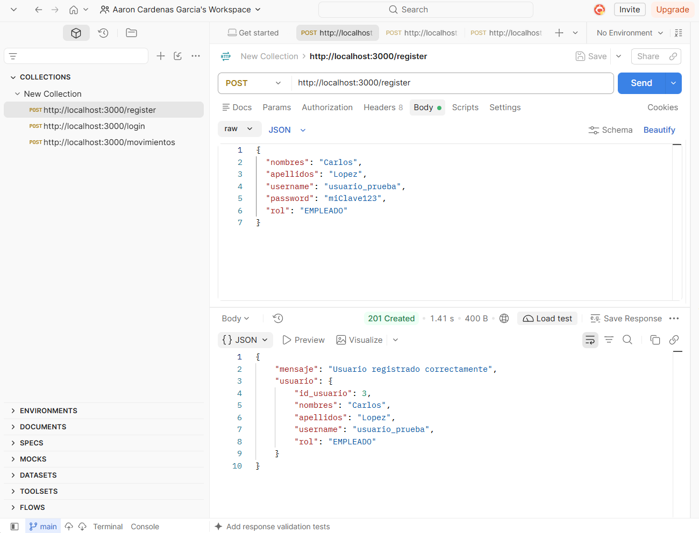
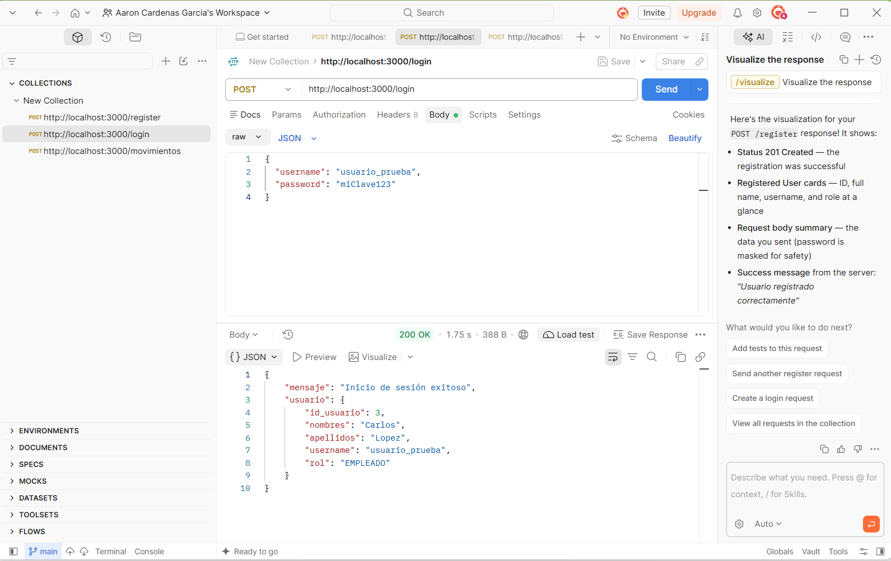
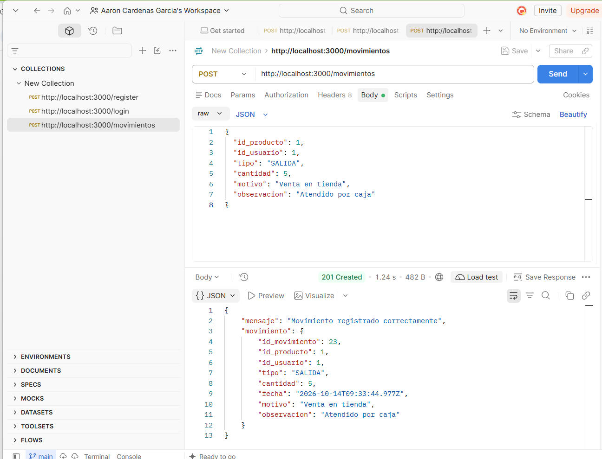

# Sistema de Gestión de Inventario - Base de Datos Distribuida

**Integrantes del Grupo:**
Cardenas Garcia, Guy Aaron.
Santiago Bevilacqua, Juan Diego.
D´nilson Joseph, Pariona Pariona.
Huaman Auris, Maria Flavia.
Tataje Baiocchi, Fabrizzio.

---

## Pregunta 1: Modelo Relacional y Script SQL
Se diseñó el modelo relacional para el control de inventario utilizando las tablas `usuarios`, `categorias`, `productos` y `movimientos`.

* **Script SQL:** Incluye llaves primarias, foráneas, restricciones de unicidad e índices para optimización.
* Ubicación en el repositorio: `./BD_inventario`

---

## Pregunta 2: Despliegue de Base de Datos en la Nube
La base de datos fue desplegada exitosamente en la plataforma **Render** utilizando **PostgreSQL**.

* **Host:** `dpg-db7c570473hc73cqucgg-a.oregon-postgres.render.com`
* **Base de Datos:** `pcdb_90ni`
* **Datos de prueba:** Se cargaron las 3 categorías iniciales y los **20 productos de prueba** requeridos.

---

## Pregunta 3: Inicio de Sesión y Autenticación con Hash
Se implementó la autenticación del usuario validando credenciales contra la base de datos remota. Las contraseñas se almacenan encriptadas mediante un algoritmo de **Hash (`bcrypt`)**.

### Evidencias en Postman:
1. **Registro de Usuario (`POST /register`):** Encripta la contraseña antes de insertarla en la base de datos.
   

2. **Inicio de Sesión (`POST /login`):** Compara la contraseña ingresada en texto plano contra el `password_hash` guardado en Render.
   

---

## Pregunta 4: Registro de Movimientos y Trigger Automático de Stock
Se programó el endpoint `POST /movimientos` para registrar entradas y salidas de mercancía.

* **Actualización Automática de Stock:** Mediante el Trigger `trg_actualizar_stock` ejecutado tras cada `INSERT` en la tabla `movimientos`, PostgreSQL actualiza automáticamente la columna `stock_actual` del producto correspondiente.

### Evidencia en Postman:
* **Registro de Salida/Venta (`POST /movimientos`):**
  

---

## Instrucciones de Ejecución Local
1. Clonar el repositorio: https://github.com/Aaron-3030/BD_Distribuida.git
2. Instalar dependencias: 
bash,
npm install
3. Iniciar el servidor: 
bash,
node server.js